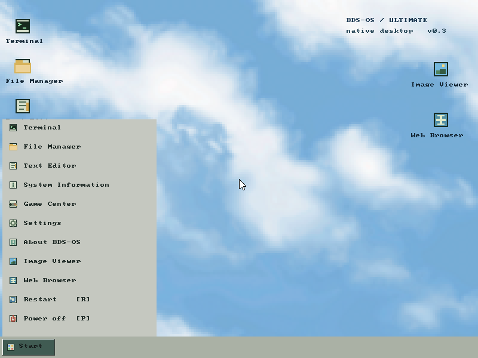
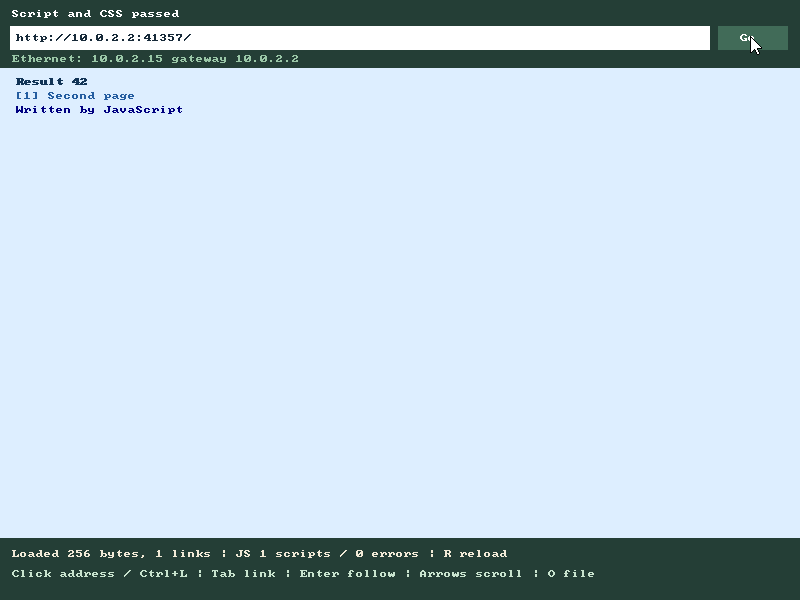

# BDS-OS Ultimate

A bootable x86 hobby operating system created by **freidtechnerd-hue with
ChatGPT GPT-6.1 Sol and GPT-6 Astra**, as featured in
[the original YouTube video](https://www.youtube.com/watch?v=oUb6CiOTym4&t=10s).
Development continued after the video was released; this repository contains
the updated source and installation instructions. See [credits](docs/CREDITS.md)
and [changes since the video](docs/CHANGELOG.md).

The main edition boots through GRUB into its own 32-bit kernel and desktop.
It does not launch Windows or Linux. QEMU/VirtualBox emulate hardware;
Linux or WSL supplies build tools. A separate 8086 floppy edition is included.

**Start here:** [installation tutorial](docs/GETTING-STARTED.md) covers
VirtualBox, QEMU, other VM software, USB/CD/DVD preparation, real hardware,
networking and troubleshooting. Download the **Public installer ISO** and its
SHA-256 file from [Releases](https://github.com/freidtechnerd-hue/bds-os/releases).
The installer erases one explicitly selected dedicated disk. That disk then
boots without the USB stick or optical media.



## Features

- Desktop, cloud wallpaper, custom cursor, three-second boot screen with
  progress bar, Start menu, and startup/system sounds.
- Terminal, File Manager, editor, calculator, system information, five small
  games, BMP/PNG viewer and MP3/MIDI player.
- Native DOOM with Freedoom, WAD picker, loading screen, music and effects;
  native InfoNES emulator with ROM picker and battery saves. Apps start in
  windows; **Ctrl+F** toggles fullscreen.
- HTTP browser compiled with Gumbo, lwIP and Elk: clickable address bar,
  links, basic CSS and limited JavaScript/DOM support. **HTTPS and modern
  web-app compatibility are not implemented.** This is not Firefox.
- DHCP for selected Intel PRO/1000, Realtek RTL8139 and AMD PCnet adapters;
  AC'97 and basic analog HDA sound.
- BIOS-discovered disks and boot-time USB storage; BDSFS/FAT12/16/32 read/write,
  ISO9660 reading. Drive browsing preserves system app resources.
- Native `.RUN` files with embedded 16×16 icons, custom PSF1 fonts and
  companion BIN/DLL/DCL data. Windows DLL execution is not supported.
- Start-menu restart/power off and boot-menu resolutions from 640×480 to
  1920×1200, subject to firmware availability.

Public builds include Freedoom with its license and credits. **Commercial NES
ROMs, commercial DOOM WADs, personal saves and private VM disks are excluded.**
Supply your own compatible game files. See [NES](docs/NES.md),
[DOOM](docs/DOOM.md), [desktop controls](docs/DESKTOP-UPGRADE.md), and
[browser/network limits](docs/NETWORK-DESKTOP.md).



## Build from source

On Debian/Ubuntu, install the tools and build a generic, ROM-free installer:

```sh
sudo apt update
sudo apt install build-essential binutils nasm grub-pc-bin grub-common \
  xorriso qemu-system-x86 python3 dosfstools mtools
make freedoom
make all
python3 tools/installer.py --data build/seed.img
```

`freedoom` downloads pinned Freedoom 0.13.0 and verifies its SHA-256. Native
engine/parser/decoder source is vendored under `third_party/`, with provenance
and licenses. The compiler emits freestanding i386 code with a BDS runtime.
The NES port is InfoNES, not FCEUX.

On Windows, install these tools inside a WSL distribution named **Ubuntu**,
then run `./build.ps1 freedoom` and `./build.ps1 all` from PowerShell. Build a
generic installer using the Python command above inside WSL. The PowerShell
`installer` target packages the current **personal** `build/data.img` instead.

| Artifact | Purpose |
| --- | --- |
| `build/bds-os-installer.iso` | BIOS USB/CD/DVD installer generated from the selected data image |
| `build/bds-os.iso` | Developer live kernel ISO; attach a separate data image for apps |
| `build/seed.img` | Rebuilt generic 64 MiB BDSFS app/data image |
| `build/data.img` | Persistent working image; ordinary rebuilds preserve it |
| `build/apps/*.run` | Compiled native i386 applications |
| `build/legacy.img` | Separate 1.44 MB 8086 bootable floppy |
| `build/logs/` | Local test logs, captures and verification reports |

`make clean` deletes the entire build directory, including saves in `data.img`.
Back it up first. Update an existing **offline** working image with
`make desktop-data`; it refreshes managed apps/assets and retains other files.
Never edit a disk image from the host while a VM is using it.

## Using the desktop

F1–F9 open Terminal, File Manager, Editor, System Information, Game Center,
Settings, About, Image Viewer and Web Browser. **F10** opens Start; its **R/P**
items restart/power off. In DOOM, F10 exits the game instead. File Manager and
game pickers use Left/Right or drive buttons to switch devices. Enter opens
an entry and Backspace goes to its parent. **Ctrl+L** focuses the browser
address field; Enter or Go navigates. **Ctrl+F** toggles app fullscreen.

Useful terminal commands:

```text
HELP
DRIVES
MOUNT 0
DIR
WRITE /NOTES.TXT "Hello from BDS-OS"
TYPE /NOTES.TXT
WEB http://neverssl.com/
NET
DOOM
NES
CHECK
```

Use paths such as `V1:/GAMES/GAME.WAD` to reference another volume without
changing the shell drive. Apps run one at a time and return to the desktop.
[Storage](docs/FILESYSTEM.md), [native RUN ABI](docs/RUN.md), and
[architecture](docs/ARCHITECTURE.md) explain the implementation.

## Tests and limitations

```sh
make test test-ui test-doom test-nes test-desktop test-storage
make test-audio test-network test-internet test-upgrade test-resolutions
# Test the currently generated installer without rebuilding its data:
python3 tests/install.py
python3 tests/install_safety.py
```

Tests boot actual binaries in disposable QEMU images. They check persistence,
loaders, input, gameplay, PCM sound, HTTP, multi-drive access, installation and
cold boot without installation media. See [verification](docs/VERIFIED.md).
VirtualBox has also been exercised; physical machines and other VM products
remain untested.

This is a single-process, cooperative system with trusted ring-0 native apps.
It has no user accounts or app isolation, no UEFI boot, no native USB/AHCI/NVMe
drivers, and no NTFS/exFAT/ext4 or GPT volume support. Storage depends on BIOS
INT 13h. USB hotplug and USB-only input are unsupported. The installer needs
at least 256 MiB RAM; the installed OS is tested at 128 MiB. Use a VM or a
dedicated experimental disk and keep backups.

Original BDS code is **GPL-2.0-or-later**; see [COPYING](COPYING).
The combined NES executable is GPL-3.0 and the combined Elk browser is
AGPL-3.0. Upstream notices, asset attribution and corresponding source
information are in [licenses/NOTICE.md](licenses/NOTICE.md).
